# BÁO CÁO PHÂN TÍCH CHẤT LƯỢNG KHÔNG KHÍ

# I. BỐI CẢNH VÀ MỤC TIÊU

## 1.1. Bối cảnh

Ô nhiễm không khí đang trở thành một trong những thách thức môi trường và sức khỏe cộng đồng nghiêm trọng nhất tại các đô thị lớn trên toàn thế giới. Theo Tổ chức Y tế Thế giới (WHO), hàng triệu ca tử vong sớm mỗi năm có liên quan đến việc tiếp xúc với bụi mịn PM2.5, PM10 và các khí độc hại như NO2, SO2, CO, O3. Việc nghiên cứu các mô hình biến đổi của chất lượng không khí theo chu kỳ thời gian (theo giờ trong ngày, ngày trong tuần, và các mùa trong năm) đóng vai trò then chốt trong việc nhận diện nguồn phát thải và đưa ra giải pháp can thiệp hiệu quả.

## 1.2. Vấn đề

Mức độ ô nhiễm không khí không cố định mà biến động liên tục dưới tác động của các hoạt động giao thông và công nghiệp. Tuy nhiên, các cơ quan quản lý và người dân thường thiếu thông tin chi tiết về các khoảng thời gian đỉnh điểm ô nhiễm, dẫn đến việc thụ động trong phòng tránh và quản lý.

## 1.3. Đối tượng sử dụng

- **Cơ quan Quản lý Môi trường:** Sử dụng kết quả để hoạch định chính sách điều tiết giao thông, quy hoạch công nghiệp và phát ra các cảnh báo chất lượng không khí kịp thời.
- **Người dân & Cộng đồng:** Tham khảo thông tin để chủ động điều chỉnh lịch trình di chuyển, sinh hoạt ngoài trời nhằm bảo vệ sức khỏe cá nhân.
- **Các Nhà Nghiên cứu Môi trường:** Sử dụng làm cơ sở tiền đề cho các mô hình dự báo không khí chuyên sâu (Machine Learning / Deep Learning).

## 1.4. Mục tiêu

- Xây dựng quy trình xử lý và làm sạch dữ liệu chuỗi thời gian về chất lượng không khí.
- Phân tích sự biến đổi của các chỉ số ô nhiễm (AQI, PM2.5, NO2, CO...) theo các trục thời gian khác nhau (giờ, ngày, tháng, mùa).
- Đánh giá mối tương quan giữa các chất ô nhiễm và chỉ số AQI.
- Trích xuất các phát hiện quan trọng (Key Findings) làm căn cứ cho công tác khuyến nghị và ra quyết định.

# II. NGUỒN VÀ TỪ ĐIỂN DỮ LIỆU

## 2.1. Nguồn dữ liệu

Bộ dữ liệu **Air Quality Data in India (2015–2020)** được công bố công khai trên Kaggle bởi Rohan Rao (rohanrao), phiên bản 12, tại địa chỉ: [https://www.kaggle.com/datasets/rohanrao/air-quality-data-in-india](https://www.kaggle.com/datasets/rohanrao/air-quality-data-in-india) (truy cập ngày 01/11/2026).

Dữ liệu gốc do Central Pollution Control Board (CPCB) — cổng thông tin chính thức của Chính phủ Ấn Độ — công bố; tác giả tổng hợp và chia thành các tệp CSV theo giờ/ngày, cấp trạm/thành phố. Bộ dữ liệu bao phủ giai đoạn 01/01/2015–01/07/2020, gồm 26 thành phố và được phát hành theo giấy phép CC0 1.0 Public Domain.

## 2.2. Thông tin bộ dữ liệu

Bộ dữ liệu gồm 5 tệp CSV với tổng cộng 69 cột:

| Tệp | Nội dung | Số dòng | Số cột |
| --- | --- | ---: | ---: |
| `station_hour.csv` | Quan trắc theo giờ ở cấp trạm | 2.589.083 | 16 |
| `station_day.csv` | Quan trắc theo ngày ở cấp trạm | 108.035 | 16 |
| `city_hour.csv` | Quan trắc theo giờ ở cấp thành phố | 707.875 | 16 |
| `city_day.csv` | Quan trắc theo ngày ở cấp thành phố | 29.531 | 16 |
| `stations.csv` | Danh mục trạm và thông tin địa lý | 230 | 5 |

Trong notebook, `station_hour.csv` là tệp gốc được làm sạch; `city_hour` và `city_day` được tổng hợp lại từ dữ liệu trạm. `stations.csv` được dùng để gắn thông tin thành phố cho từng trạm; `station_day.csv` có trong bộ dữ liệu nhưng không được dùng trực tiếp trong phân tích này.

## 2.3. Mô tả dữ liệu

Bộ dữ liệu cung cấp nồng độ 12 chất ô nhiễm — PM2.5, PM10, NO, NO2, NOx, NH3, CO, SO2, O3, Benzene, Toluene và Xylene — cùng chỉ số AQI và nhóm AQI (`AQI_Bucket`) tại các trạm quan trắc thuộc 26 thành phố của Ấn Độ. Dữ liệu có cả độ phân giải giờ và ngày, ở cấp trạm và cấp thành phố.

## 2.4. Từ điển dữ liệu

| STT | Tên biến | Kiểu dữ liệu | Ý nghĩa | Đơn vị / Giá trị | Vai trò |
| --- | --- | --- | --- | --- | --- |
| 1 | `StationId` | Categorical | Mã định danh trạm quan trắc | String (VD: AP001) | Biến phân nhóm |
| 2 | `Datetime` | Datetime | Thời điểm ghi nhận dữ liệu (giờ) | YYYY-MM-DD HH:MM | Mốc thời gian |
| 3 | `PM2.5` | Float | Nồng độ bụi mịn PM2.5 | µg/m³ | Chất ô nhiễm chính |
| 4 | `PM10` | Float | Nồng độ bụi thô PM10 | µg/m³ | Chất ô nhiễm |
| 5 | `NO` | Float | Nồng độ Nitric Oxide | µg/m³ | Chất ô nhiễm |
| 6 | `NO2` | Float | Nồng độ Nitrogen Dioxide | µg/m³ | Chất ô nhiễm |
| 7 | `NOx` | Float | Nồng độ các oxit nitơ | ppb | Chất ô nhiễm |
| 8 | `NH3` | Float | Nồng độ Ammonia | µg/m³ | Chất ô nhiễm |
| 9 | `CO` | Float | Nồng độ Carbon Monoxide | mg/m³ | Chất ô nhiễm |
| 10 | `SO2` | Float | Nồng độ Sulphur Dioxide | µg/m³ | Chất ô nhiễm |
| 11 | `O3` | Float | Nồng độ Ozone | µg/m³ | Chất ô nhiễm |
| 12 | `Benzene` | Float | Nồng độ Benzene | µg/m³ | Chất ô nhiễm |
| 13 | `Toluene` | Float | Nồng độ Toluene | µg/m³ | Chất ô nhiễm |
| 14 | `Xylene` | Float | Nồng độ Xylene | µg/m³ | Chất ô nhiễm |
| 15 | `AQI` | Float | Chỉ số chất lượng không khí tổng hợp | 0–500 | Biến đánh giá tổng quan |
| 16 | `AQI_Bucket` | Categorical | Nhóm chất lượng không khí | Good, Satisfactory, Moderate, Poor, Very Poor, Severe | Biến phân loại |

*Ghi chú: `city_hour.csv` và `city_day.csv` dùng cột `City` thay cho `StationId`; `city_day.csv` và `station_day.csv` dùng cột `Date` thay cho `Datetime`. `stations.csv` gồm các cột `StationId`, `StationName`, `City`, `State` và `Status`.*

# III. LÀM SẠCH DỮ LIỆU

Phần này tương ứng với mục 2 trong notebook. Quy trình được thực hiện trên tệp `station_hour.csv` thực tế của bộ dữ liệu: 2.589.083 dòng, 16 cột, giai đoạn từ 01/01/2015 đến 01/07/2020. Mục tiêu là kiểm tra lỗi, xử lý các giá trị bất thường, điền các khoảng thiếu ngắn và tính lại AQI từ dữ liệu đã làm sạch.

## 3.1. Kiểm tra dữ liệu

Bước đầu tiên là rà soát các lỗi thường gặp trong dữ liệu chuỗi thời gian: dòng trùng lặp, trùng khóa `StationId + Datetime`, trạm không có trong danh mục, thời gian sai định dạng, ô số không chuyển được sang kiểu số và tỷ lệ dữ liệu thiếu. Kết quả được tổng hợp trong bảng dưới đây.

**Bảng 1. Kết quả kiểm tra chất lượng dữ liệu**

| Vấn đề | Số lượng | Mẫu số tính tỷ lệ | Tỷ lệ (%) |
| --- | ---: | ---: | ---: |
| Trùng toàn bộ dòng | 0 | 2.589.083 | 0,000 |
| Trùng `StationId + Datetime` | 0 | 2.589.083 | 0,000 |
| `StationId` không thuộc danh mục trạm | 0 | 2.589.083 | 0,000 |
| Ô `Datetime` sai định dạng | 0 | 2.589.083 | 0,000 |
| Ô cột số không chuyển được sang numeric | 0 | 33.658.079 | 0,000 |
| Tổng ô sai kiểu dữ liệu | 0 | 36.247.162 | 0,000 |
| Dữ liệu thiếu | 11.664.492 | 41.425.328 | 28,158 |

Dữ liệu không có dòng trùng, không có thời gian sai định dạng, không có trạm lạ và không có lỗi kiểu dữ liệu. Vấn đề chính là dữ liệu thiếu: khoảng 28,16% số ô, tương đương hơn 11,6 triệu ô. Mức thiếu không đồng đều giữa các chất; Xylene, NH3 và PM10 là những cột thiếu nhiều nhất.

**Bảng 2. Tỷ lệ thiếu theo từng chất ô nhiễm**

| Chất | Số ô thiếu | Tỷ lệ trên tổng số dòng (%) |
| --- | ---: | ---: |
| PM2.5 | 659.349 | 25,47 |
| PM10 | 1.126.423 | 43,51 |
| NO | 612.835 | 23,67 |
| NO2 | 544.700 | 21,04 |
| NOx | 588.834 | 22,74 |
| NH3 | 1.246.719 | 48,15 |
| CO | 617.254 | 23,84 |
| SO2 | 764.196 | 29,52 |
| O3 | 741.639 | 28,64 |
| Benzene | 1.079.329 | 41,69 |
| Toluene | 1.232.318 | 47,60 |
| Xylene | 2.179.905 | 84,20 |

## 3.2. Xử lý dữ liệu

Quy trình xử lý gồm ba nhóm vấn đề chính: giá trị trần do cảm biến bão hòa, chuỗi giá trị 0 kéo dài bất thường và các khoảng thiếu ngắn. Sau khi xử lý, AQI được tính lại theo công thức CPCB để phục vụ phân tích.

### 3.2.1. Giá trị trần

Một số cảm biến ghi giá trị rất cao và lặp lại: PM2.5 trong khoảng 985–1.000 và PM10 trong khoảng 999,99–1.000. Đây là giới hạn đo của thiết bị, không phải nồng độ thực. Bảng dưới đây liệt kê các giá trị xuất hiện nhiều nhất trong vùng cực trị.

**Bảng 3. Các giá trị trần xuất hiện nhiều nhất**

| Hạng | PM2.5 (giá trị / số lần) | PM10 (giá trị / số lần) |
| ---: | --- | --- |
| 1 | 999,99 / 478 | 999,99 / 236 |
| 2 | 995,00 / 213 | 1.000,00 / 189 |
| 3 | 985,00 / 188 | 985,00 / 77 |
| 4 | 1.000,00 / 182 | 947,00 / 42 |
| 5 | 912,08 / 10 | 994,50 / 41 |

Tổng cộng có 1.486 giá trị bị đánh dấu là giá trị trần: PM2.5 có 1.061 giá trị (0,055% số giá trị hợp lệ) và PM10 có 425 giá trị (0,029%). Các giá trị này được đổi thành thiếu để không làm sai lệch trung bình, độ lệch chuẩn và hệ số tương quan. Hình 1 cho thấy các điểm đỏ tập trung thành dải ở ngưỡng 985–1.000 trong toàn bộ giai đoạn; Hình 2 phóng to giai đoạn 2015–2016 để thấy rõ tính chất lặp lại của các giá trị này.

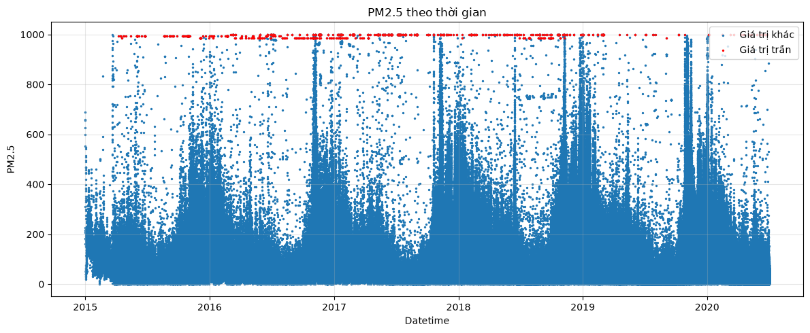

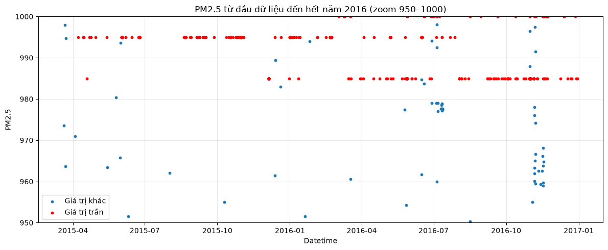

### 3.2.2. Chuỗi 0 dài

Các cảm biến đôi khi trả về 0 liên tục trong nhiều ngày. Đây có thể là lỗi thiết bị hoặc giai đoạn mất tín hiệu, không phản ánh nồng độ thực. Quy tắc xử lý là coi chuỗi 0 kéo dài từ 7 ngày trở lên là lỗi và đổi thành thiếu; các chuỗi 0 ngắn hơn được giữ lại vì có thể là giá trị thật.

**Bảng 4. Số giá trị 0 thuộc các chuỗi dài từ 7 ngày trở lên**

| Chất | Số lượng đánh dấu | Tổng giá trị hợp lệ | Tỷ lệ (%) |
| --- | ---: | ---: | ---: |
| NOx | 71.410 | 2.098.275 | 3,403 |
| CO | 92.745 | 2.089.781 | 4,438 |
| Benzene | 185.247 | 1.727.504 | 10,723 |
| Toluene | 163.286 | 1.546.717 | 10,557 |
| Xylene | 91.233 | 513.979 | 17,750 |
| Các chất còn lại | 0 | — | 0,000 |

Tổng cộng 603.921 giá trị bị đánh dấu, chủ yếu ở Xylene (17,75%), Benzene (10,72%), Toluene (10,56%), CO (4,44%) và NOx (3,40%). Bảng 5 liệt kê các chuỗi 0 dài nhất; nhiều chuỗi kéo dài 3–4 tháng, tập trung ở các trạm DL007, DL030, DL014 và MH005. Trạm TG005 cũng có chuỗi 0 dài, được minh họa ở Hình 3.

**Bảng 5. Các chuỗi 0 dài nhất theo trạm và chất**

| Trạm | Chất | Bắt đầu | Kết thúc | Số dòng | Số ngày |
| --- | --- | --- | --- | ---: | ---: |
| DL030 | Benzene, Toluene, Xylene | 15/12/2017 11:00 | 12/04/2018 12:00 | 2.834 | 118,04 |
| DL007 | Toluene | 02/01/2018 11:00 | 26/04/2018 21:00 | 2.747 | 114,42 |
| DL014 | NOx | 07/11/2016 18:00 | 21/02/2017 12:00 | 2.539 | 105,75 |
| MH005 | CO | 06/08/2015 11:00 | 19/11/2015 03:00 | 2.513 | 104,67 |
| DL007 | Benzene, Toluene, Xylene | 16/10/2018 11:00 | 27/01/2019 12:00 | 2.474 | 103,04 |
| DL007 | Benzene, Toluene, Xylene | 29/06/2018 11:00 | 08/10/2018 13:00 | 2.427 | 101,08 |
| DL007 | Benzene, Toluene, Xylene | 08/04/2019 18:00 | 29/06/2019 12:00 | 1.963 | 81,75 |
| DL008 | NOx | 15/01/2017 18:00 | 03/04/2017 17:00 | 1.872 | 77,96 |

Hình 3 minh họa trường hợp trạm TG005: các đoạn NOx bằng 0 liên tiếp được tô đỏ, cho thấy có những giai đoạn cảm biến "kẹt" ở giá trị 0 trong thời gian dài.

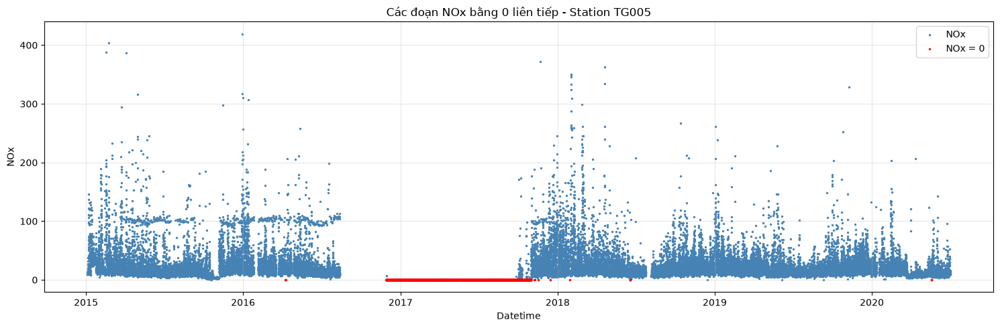

### 3.2.3. Điền chỗ thiếu

Sau khi loại giá trị trần và chuỗi 0 dài, chỉ những ô thiếu đơn lẻ (1 giờ) có đủ giá trị của giờ trước và giờ sau trong cùng trạm mới được điền. Giá trị điền là trung bình cộng của hai giờ kề cận. Các khoảng thiếu dài hơn được giữ nguyên để tránh tạo ra dữ liệu giả.

**Bảng 6. Số ô thiếu đơn lẻ được điền**

| Chất | Số ô được điền | Tổng giá trị hợp lệ | Tỷ lệ (%) |
| --- | ---: | ---: | ---: |
| PM2.5 | 10.676 | 1.940.333 | 0,550 |
| PM10 | 8.115 | 1.469.406 | 0,552 |
| NO | 10.541 | 2.035.372 | 0,518 |
| NO2 | 8.415 | 2.060.110 | 0,408 |
| NOx | 7.841 | 2.026.865 | 0,387 |
| NH3 | 5.932 | 1.352.465 | 0,439 |
| CO | 12.272 | 1.997.036 | 0,615 |
| SO2 | 14.845 | 1.846.346 | 0,804 |
| O3 | 9.122 | 1.863.110 | 0,490 |
| Benzene | 5.465 | 1.542.257 | 0,354 |
| Toluene | 4.982 | 1.383.431 | 0,360 |
| Xylene | 1.230 | 422.746 | 0,291 |

Tổng cộng khoảng 99.436 ô được điền, chiếm tỷ lệ nhỏ so với tổng dữ liệu. Cách điền này chỉ lấp các khoảng trống ngắn, không làm thay đổi cấu trúc phân bố của chuỗi.

### 3.2.4. So sánh trước và sau khi làm sạch

Hình 4 so sánh phân bố của 12 chất trước và sau bước xử lý/điền khuyết. Số ô thiếu giảm rõ rệt, nhưng trung bình, trung vị và độ lệch chuẩn thay đổi không lớn; phân bố của hầu hết các chất vẫn giữ hình dạng cũ. Điều này cho thấy quy trình xử lý chủ yếu loại bỏ các điểm bất thường và lấp khoảng trống ngắn, không làm méo phân bố tổng thể.

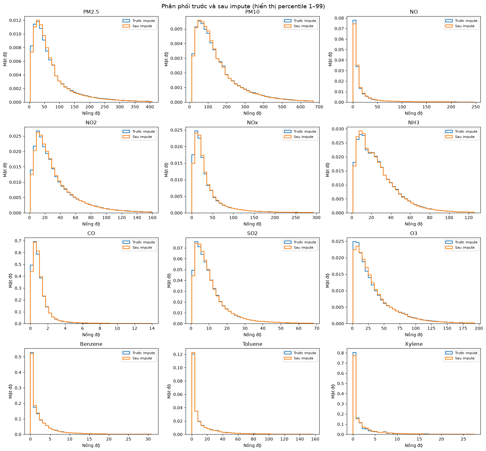

**Bảng 7. So sánh nhanh trước và sau xử lý**

| Chất | Thiếu trước | Thiếu sau | Giảm thiếu (%) | Trung bình trước → sau | Trung vị trước → sau | Độ lệch chuẩn trước → sau |
| --- | ---: | ---: | ---: | --- | --- | --- |
| PM2.5 | 659.349 | 227.636 | 65,5 | 79,51 → 77,58 | 52,29 → 52,25 | 84,73 → 80,73 |
| PM10 | 1.126.423 | 846.015 | 24,9 | 157,26 → 154,30 | 115,98 → 114,00 | 137,57 → 133,63 |
| NO | 612.835 | 100.765 | 83,6 | 21,55 → 21,42 | 6,90 → 7,30 | 46,64 → 44,79 |
| NO2 | 544.700 | 83.683 | 84,6 | 34,95 → 34,78 | 24,69 → 24,95 | 34,31 → 33,10 |
| NOx | 588.834 | 82.938 | 85,9 | 41,21 → 41,43 | 23,60 → 24,43 | 55,27 → 53,40 |
| NH3 | 1.246.719 | 989.759 | 20,6 | 28,53 → 28,26 | 22,30 → 21,98 | 27,08 → 26,62 |
| CO | 617.254 | 83.222 | 86,5 | 1,45 → 1,56 | 0,83 → 0,86 | 4,76 → 5,12 |
| SO2 | 764.196 | 324.796 | 57,5 | 11,78 → 11,98 | 8,16 → 8,21 | 13,82 → 14,00 |
| O3 | 741.639 | 357.797 | 51,8 | 37,81 → 38,12 | 24,57 → 25,11 | 46,94 → 47,08 |
| Benzene | 1.079.329 | 536.522 | 50,3 | 3,58 → 3,41 | 1,29 → 1,28 | 12,21 → 11,15 |
| Toluene | 1.232.318 | 700.708 | 43,1 | 16,26 → 15,62 | 4,70 → 4,40 | 33,61 → 32,04 |
| Xylene | 2.179.905 | 1.963.766 | 9,9 | 2,73 → 2,63 | 0,53 → 0,59 | 8,13 → 7,38 |

*Ghi chú: Bảng so sánh được tính theo quy trình đánh giá của notebook, bao gồm loại giá trị trần, chuỗi 0 dài, các đột biến theo quy tắc IQR trượt 48 giờ và bước điền khuyết theo nhóm (trạm, tháng, ngày, giờ). Vì vậy, số ô thiếu sau xử lý trong bảng này thấp hơn so với bước điền đơn lẻ ở mục 3.2.3.*

### 3.2.5. Tính AQI

AQI được tính lại theo công thức của Ủy ban Kiểm soát Ô nhiễm Trung ương Ấn Độ (CPCB). Với mỗi chất, chỉ số phụ (sub-index) được nội suy tuyến tính từ nồng độ theo các ngưỡng breakpoint; AQI là giá trị lớn nhất trong các chỉ số phụ. Cách tính này phản ánh nguyên tắc "chất ô nhiễm quyết định" — AQI chịu ảnh hưởng mạnh nhất từ chất có chỉ số phụ cao nhất.

**Bảng 8. Cửa sổ lấy trung bình khi tính AQI**

| Nhóm chất | Cửa sổ tính | Số giờ tối thiểu |
| --- | --- | ---: |
| PM2.5, PM10, SO2, NOx, NH3 | Trung bình 24 giờ | 16 |
| CO, O3 | Cực đại 8 giờ | 1 |

Các mức AQI được phân loại như sau: Good (0–50), Satisfactory (51–100), Moderate (101–200), Poor (201–300), Very Poor (301–400) và Severe (>400).

### 3.2.6. Đánh giá AQI

Để kiểm tra quy trình tính AQI, AQI gốc có sẵn trong dữ liệu được so sánh với AQI tính lại từ dữ liệu đã làm sạch. Hình 5 trình bày kết quả tại trạm AP001 (25/11/2017–01/07/2020), trạm có chuỗi AQI gốc dài và liên tục.

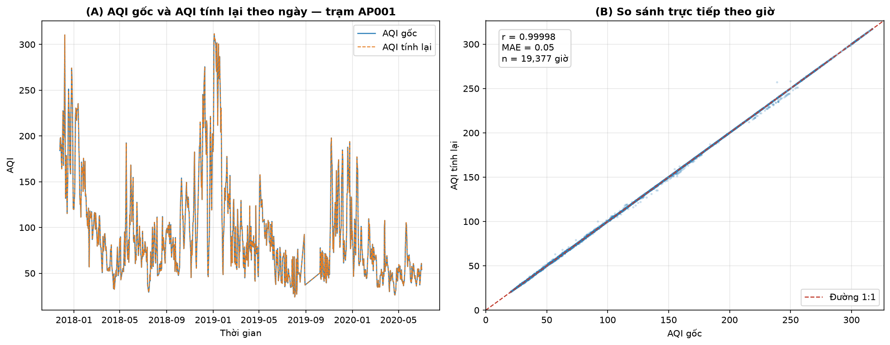

Trên 19.377 giờ có đủ cả hai giá trị, AQI gốc và AQI tính lại gần như trùng khớp: hệ số tương quan Pearson đạt 0,99998, sai số tuyệt đối trung bình (MAE) chỉ 0,05 và trung vị của cả hai chuỗi đều bằng 78,0. Có 97,16% số giờ cho kết quả hoàn toàn giống nhau; khi có khác biệt, AQI tính lại thấp hơn ở 1,73% số giờ và cao hơn ở 1,10% số giờ. Chênh lệch lớn nhất là 18 điểm, xảy ra tại một đỉnh ngắn hạn ngày 11/01/2018 (239 so với 257). Nhìn chung, hai đường biến động cùng xu hướng; AQI tính lại chủ yếu xác nhận quy trình tái lập công thức CPCB và có thể dùng làm biến phân tích nhất quán cho toàn bộ giai đoạn.

# IV. PHÂN TÍCH

Phần này tương ứng với mục 3 trong notebook. Dữ liệu phân tích ở cấp thành phố, sử dụng hai bảng `city_day` và `city_hour` được tổng hợp từ dữ liệu trạm đã làm sạch.

## 4.1. Dữ liệu cấp thành phố

Dữ liệu trạm được gộp với danh mục thành phố theo `StationId`, sau đó tính trung bình theo `(City, Datetime)` để tạo bảng cấp giờ và theo `(City, Date)` để tạo bảng cấp ngày. Các biến thời gian như năm, tháng, giờ, ngày cuối tuần và mùa được bổ sung để phục vụ phân tích. Các phân tích dưới đây sử dụng AQI tính lại từ dữ liệu đã làm sạch (`AQI_calculated`).

**Bảng 9. Quy mô dữ liệu cấp thành phố**

| Bảng | Số dòng | Số thành phố | Khoảng thời gian |
| --- | ---: | ---: | --- |
| `city_hour` | 707.875 | 26 | 01/01/2015 – 01/07/2020 |
| `city_day` | 29.531 | 26 | 01/01/2015 – 01/07/2020 |

Các mùa được phân loại theo chuẩn của Cục Khí tượng Ấn Độ (IMD): Winter (tháng 12–2), Summer (tháng 3–5), Monsoon (tháng 6–9) và Post-monsoon (tháng 10–11). AQI cấp ngày được phân vào các nhóm Good, Satisfactory, Moderate, Poor, Very Poor và Severe theo các ngưỡng đã nêu.

## 4.2. Thống kê mô tả

Bảng 10 tổng hợp các thống kê mô tả chính của các chất ô nhiễm và AQI trên dữ liệu cấp ngày.

**Bảng 10. Thống kê mô tả dữ liệu cấp ngày**

| Chất | Trung bình | Trung vị | Q25 | Q75 | Độ lệch chuẩn | IQR | Độ lệch (skewness) | Kurtosis |
| --- | ---: | ---: | ---: | ---: | ---: | ---: | ---: | ---: |
| PM2.5 | 66,45 | 48,40 | 28,82 | 79,82 | 61,51 | 51,00 | 2,98 | 15,75 |
| PM10 | 117,87 | 95,76 | 56,29 | 149,44 | 89,82 | 93,15 | 1,98 | 6,01 |
| NO2 | 28,61 | 21,70 | 11,75 | 37,75 | 24,52 | 26,00 | 2,46 | 11,21 |
| CO | 2,41 | 0,96 | 0,60 | 1,53 | 7,18 | 0,93 | 8,75 | 106,69 |
| SO2 | 14,55 | 9,16 | 5,66 | 15,27 | 18,19 | 9,60 | 4,09 | 22,10 |
| O3 | 34,56 | 30,87 | 18,88 | 45,65 | 21,75 | 26,77 | 1,32 | 3,32 |
| AQI | 165,16 | 117,04 | 80,85 | 204,60 | 139,57 | 123,74 | 3,45 | 22,15 |

PM2.5 có trung vị 48,40 µg/m³, cao hơn khoảng 3,2 lần khuyến nghị 24 giờ của WHO (15 µg/m³). AQI trung vị là 117,04, thuộc mức Moderate. Ở hầu hết các chất, trung bình lớn hơn trung vị, cho thấy phân bố lệch phải do các đợt ô nhiễm cao. CO có độ lệch và kurtosis đặc biệt lớn (8,75 và 106,69), phản ánh các đỉnh cục bộ rất cao. Vì vậy, trung vị và khoảng tứ phân vị (IQR) phù hợp hơn trung bình và độ lệch chuẩn khi mô tả dữ liệu này.

Hình 6 trình bày ma trận tương quan Spearman giữa các chất và AQI. AQI tương quan mạnh nhất với PM10 (ρ = 0,87) và PM2.5 (ρ = 0,85), cho thấy bụi mịn là yếu tố quyết định mức AQI. NO, NO2 và NOx đi cùng nhau (NO–NOx ρ = 0,78; NO2–NOx ρ = 0,68). O3 tương quan âm nhẹ với NO (ρ = −0,06) và tương quan dương yếu với NO2 (ρ = 0,31). Nhóm benzene, toluene và xylene cũng có tương quan nội nhóm đáng kể (benzene–toluene ρ = 0,74).

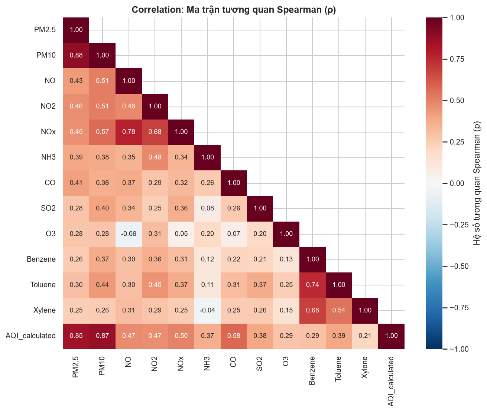

## 4.3. So sánh theo nhóm

### 4.3.1. Theo thành phố

Bảng 11 giới hạn ở 10 thành phố có AQI trung vị cao nhất và 5 thành phố có AQI trung vị thấp nhất để làm nổi bật sự khác biệt giữa các vùng.

**Bảng 11. AQI và PM2.5 theo thành phố**

| Thành phố | AQI trung vị | AQI trung bình | PM2.5 trung vị (µg/m³) | IQR AQI |
| --- | ---: | ---: | ---: | ---: |
| Ahmedabad | 384,79 | 451,88 | 58,36 | 314,23 |
| Delhi | 256,43 | 259,00 | 94,21 | 184,70 |
| Gurugram | 206,00 | 221,05 | 89,87 | 194,56 |
| Patna | 204,50 | 235,53 | 86,29 | 213,10 |
| Lucknow | 196,73 | 216,97 | 85,56 | 210,83 |
| Jorapokhar | 133,27 | 159,09 | 60,75 | 81,13 |
| Talcher | 127,92 | 173,15 | 44,25 | 137,64 |
| Brajrajnagar | 122,25 | 149,88 | 60,63 | 86,22 |
| Jaipur | 121,42 | 132,12 | 49,61 | 62,90 |
| Bhopal | 119,62 | 132,77 | 44,84 | 52,55 |
| Amaravati | 78,50 | 95,30 | 28,09 | 59,98 |
| Coimbatore | 75,08 | 73,16 | 28,51 | 21,99 |
| Thiruvananthapuram | 67,81 | 75,76 | 22,35 | 32,08 |
| Shillong | 48,25 | 53,76 | 17,59 | 34,41 |
| Aizawl | 22,83 | 34,80 | 10,55 | 30,12 |

Ahmedabad, Delhi, Gurugram, Patna và Lucknow là những thành phố ô nhiễm nhất, với AQI trung vị từ 196,73 đến 384,79. Delhi có khoảng 65% số ngày ở mức Poor trở lên. Ở phía ngược lại, Aizawl, Shillong và Thiruvananthapuram có AQI trung vị thấp nhất (22,83–67,81), phản ánh điều kiện không khí sạch hơn. Khoảng cách giữa nhóm cao nhất và thấp nhất lên tới gần 17 lần, cho thấy ô nhiễm không khí mang tính cục bộ rất rõ.

Cần lưu ý AQI là chỉ số tổng hợp, lấy theo chất có chỉ số phụ cao nhất; vì vậy AQI cao không nhất thiết đi kèm PM2.5 cao. Tại Ahmedabad, PM2.5 trung vị là 58,36 µg/m³ nhưng AQI trung vị lên tới 384,79, cho thấy PM10 hoặc các chất khác đóng vai trò quan trọng trong AQI của thành phố này.

### 4.3.2. Theo mùa

**Bảng 12. AQI và PM2.5 theo mùa khí tượng**

| Mùa | AQI trung vị | AQI trung bình | PM2.5 trung vị (µg/m³) | PM10 trung vị (µg/m³) | IQR AQI | Tỷ lệ ngày Poor+ (%) |
| --- | ---: | ---: | ---: | ---: | ---: | ---: |
| Winter | 170,54 | 219,89 | 74,55 | 132,96 | 198,97 | 35,95 |
| Summer | 114,76 | 146,44 | 44,45 | 91,81 | 90,89 | 16,71 |
| Monsoon | 88,58 | 113,74 | 30,94 | 59,64 | 58,31 | 8,47 |
| Post-monsoon | 153,06 | 213,99 | 67,96 | 115,91 | 207,94 | 34,48 |

Mùa đông có AQI trung vị 170,54 và 35,95% số ngày ở mức Poor trở lên. Mùa mưa có mức thấp nhất (AQI trung vị 88,58; 8,47% ngày Poor). Như vậy, AQI mùa đông cao hơn gần 2 lần so với mùa mưa. Nguyên nhân chính là hiện tượng nghịch nhiệt và ít gió vào mùa đông, khiến các chất ô nhiễm tích tụ gần mặt đất; trong khi mưa mùa hè rửa trôi bụi và làm loãng nồng độ. Mức chênh lệch giữa mùa đông và mùa mưa không giống nhau ở mọi thành phố: Guwahati cao gấp 6,15 lần, Kolkata 4,37 lần, Lucknow 3,41 lần và Patna 3,39 lần.

### 4.3.3. Ngày thường và cuối tuần

**Bảng 13. So sánh nồng độ trung bình và trung vị giữa ngày thường và cuối tuần**

| Chất | TB ngày thường | TB cuối tuần | Chênh lệch TB (%) | Trung vị ngày thường | Trung vị cuối tuần | Chênh lệch trung vị (%) |
| --- | ---: | ---: | ---: | ---: | ---: | ---: |
| PM2.5 | 66,76 | 65,66 | −1,65 | 48,47 | 48,18 | −0,60 |
| PM10 | 118,74 | 115,66 | −2,60 | 95,89 | 95,37 | −0,54 |
| NO2 | 28,85 | 27,99 | −2,96 | 21,94 | 21,04 | −4,14 |
| CO | 2,42 | 2,39 | −1,31 | 0,97 | 0,93 | −4,30 |
| SO2 | 14,57 | 14,48 | −0,67 | 9,21 | 9,02 | −2,12 |
| O3 | 34,44 | 34,88 | +1,28 | 30,71 | 31,21 | +1,62 |
| AQI | 166,00 | 163,07 | −1,77 | 117,06 | 116,96 | −0,09 |

Chênh lệch cuối tuần rất nhỏ, dưới 5% ở hầu hết các chất. O3 là ngoại lệ duy nhất khi cao hơn nhẹ vào cuối tuần (khoảng 1,3–1,6%). Kết quả này cho thấy các nguồn phát thải nền như nhà máy điện than, đun nấu và xe tải hoạt động cả tuần, nên không giảm rõ vào cuối tuần. Các chính sách chỉ hạn chế giao thông vào cuối tuần sẽ không đủ để cải thiện chất lượng không khí.

### 4.3.4. Chu kỳ 24 giờ

**Bảng 14. Giờ đỉnh, giờ đáy và biên độ dao động trong ngày**

| Chất | Giờ đỉnh | Giá trị đỉnh | Giờ đáy | Giá trị đáy | Biên độ đỉnh/đáy |
| --- | ---: | ---: | ---: | ---: | ---: |
| PM2.5 | 23 | 80,17 | 17 | 51,15 | 1,57 |
| NO2 | 20 | 40,62 | 15 | 22,42 | 1,81 |
| CO | 22 | 4,51 | 16 | 1,49 | 3,03 |
| O3 | 15 | 55,68 | 7 | 21,61 | 2,58 |

PM2.5, NO2 và CO cao nhất vào buổi tối (20–23 giờ) và thấp nhất vào buổi chiều (15–17 giờ). O3 có xu hướng ngược lại: thấp nhất lúc 7 giờ và cao nhất lúc 15 giờ do phản ứng quang hóa. Biểu đồ chu kỳ 24 giờ còn cho thấy thêm một đỉnh phụ vào buổi sáng (8–10 giờ) của PM2.5, NO2 và CO, trùng với giờ cao điểm giao thông.

### 4.3.5. Xu hướng theo năm

**Bảng 15. Diễn biến AQI và các chất chính theo năm**

| Năm | Số thành phố | Số ngày có AQI | AQI trung vị | PM2.5 trung vị (µg/m³) | NO2 trung vị (µg/m³) |
| --- | ---: | ---: | ---: | ---: | ---: |
| 2015 | 9 | 1.830 | 171,09 | 57,11 | 18,41 |
| 2016 | 10 | 2.573 | 144,33 | 61,16 | 25,01 |
| 2017 | 17 | 3.244 | 127,80 | 60,34 | 25,61 |
| 2018 | 18 | 5.729 | 124,17 | 53,61 | 26,79 |
| 2019 | 23 | 7.075 | 109,06 | 44,01 | 20,80 |
| 2020 | 26 | 4.429 | 93,29 | 34,13 | 15,36 |

AQI trung vị giảm từ 171,09 (2015) xuống 93,29 (2020), cùng với PM2.5 và NO2. Tuy nhiên, 2020 chỉ có dữ liệu đến tháng 7 và thiếu mùa đông — giai đoạn ô nhiễm nhất trong năm. Số lượng thành phố cũng tăng từ 9 lên 26, làm thay đổi thành phần mẫu qua các năm. Vì vậy, chưa thể kết luận không khí đã cải thiện bền vững chỉ dựa trên chuỗi số này.

## 4.4. Biểu đồ

### 4.4.1. Biểu đồ 1 — Tỷ lệ ngày theo mức AQI

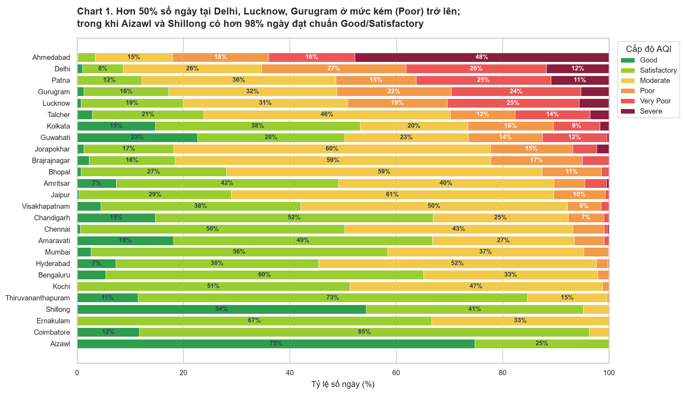

Delhi có khoảng 65% số ngày ở mức Poor trở lên. Aizawl có 98% ngày đạt Good/Satisfactory; Shillong khoảng 63%. Ahmedabad có tỷ lệ ngày Severe cao nhất, phản ánh mức ô nhiễm nền rất cao.

### 4.4.2. Biểu đồ 2 — PM2.5 theo tháng và thành phố

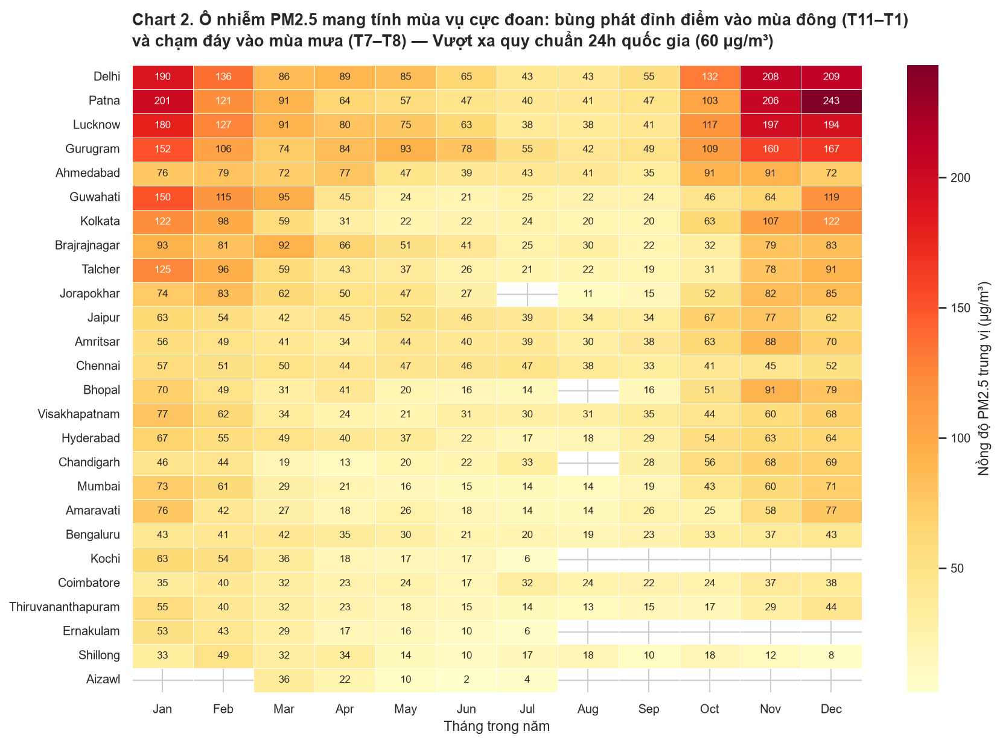

PM2.5 cao nhất vào tháng 11–1 và thấp nhất vào tháng 7–9. Các thành phố phía bắc có mức cao hơn rõ rệt, đặc biệt vào mùa đông: Delhi đạt 208–209 µg/m³ vào tháng 11–12, Patna lên tới 243 µg/m³ vào tháng 12. Mùa mưa (tháng 7–9) là giai đoạn sạch nhất ở hầu hết các thành phố.

### 4.4.3. Biểu đồ 3, 4 — Chu kỳ 24 giờ

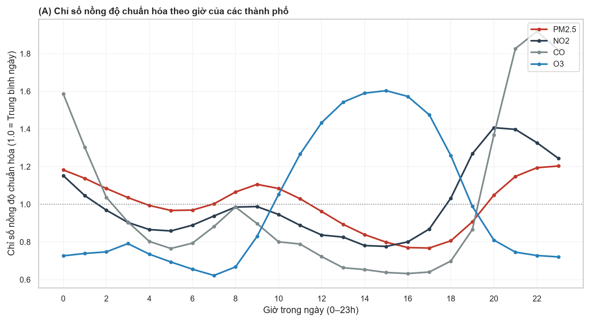

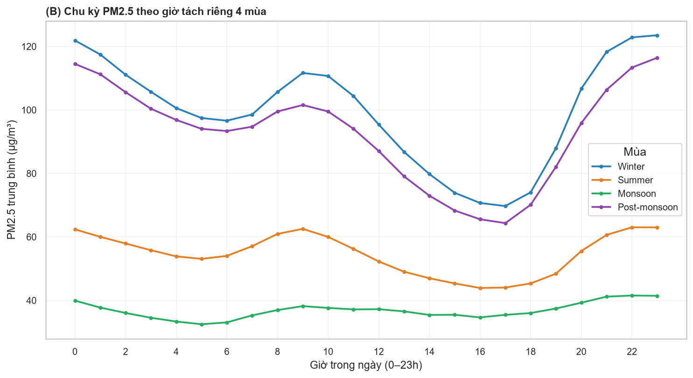

PM2.5, NO2 và CO có hai đỉnh: buổi sáng (8–10 giờ) và buổi tối (20–23 giờ). O3 đạt đỉnh vào đầu giờ chiều (13–15 giờ). Mùa đông có biên độ dao động lớn nhất; vào cùng thời điểm ban đêm, PM2.5 mùa đông cao gấp khoảng 3 lần mùa mưa.

### 4.4.4. Biểu đồ 5 — Ảnh hưởng của phong tỏa COVID-19

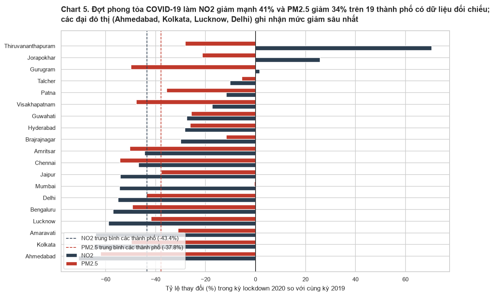

Trong giai đoạn phong tỏa (25/03–31/05/2020), NO2 và PM2.5 đều giảm mạnh so với cùng kỳ 2019. Tùy cách tính, NO2 giảm khoảng 41–43% và PM2.5 giảm khoảng 34–38%; trung bình theo từng thành phố là −43,4% và −37,8%. NO2 giảm nhiều hơn vì gắn trực tiếp với giao thông; PM2.5 giảm ít hơn do vẫn còn nguồn phát thải từ điện than và đun nấu. Mức giảm không đồng đều: các đại đô thị như Ahmedabad, Kolkata, Lucknow và Delhi ghi nhận mức giảm sâu nhất, trong khi một vài thành phố có NO2 tăng.

## 4.5. Kết luận

- Ô nhiễm cao nhất ở Ahmedabad, Delhi, Gurugram, Patna và Lucknow; Aizawl và Shillong có không khí sạch nhất.
- Mùa đông ô nhiễm hơn mùa mưa rõ rệt, với AQI trung vị cao gần gấp hai lần (170,54 so với 88,58).
- Cuối tuần gần như không khác ngày thường (chênh lệch dưới 5% ở hầu hết các chất), cho thấy nguồn phát thải nền chiếm ưu thế.
- PM2.5, NO2, CO có hai đỉnh trong ngày (sáng 8–10 giờ và tối 20–23 giờ); O3 đạt đỉnh vào đầu giờ chiều (13–15 giờ) do phản ứng quang hóa.
- Phong tỏa COVID-19 làm NO2 và PM2.5 giảm mạnh (trung bình −43,4% và −37,8%), cho thấy giao thông là nguồn phát thải lớn.
- AQI tính lại bám sát AQI gốc (tương quan 0,99998; MAE 0,05), nên có thể dùng làm biến phân tích nhất quán.

**Hạn chế:**

- Dữ liệu còn thiếu nhiều, đặc biệt ở Xylene, NH3 và PM10.
- AQI tính lại chỉ nên dùng để tham khảo vì phụ thuộc vào quy trình làm sạch và cửa sổ lấy trung bình.
- Dữ liệu năm 2020 chỉ đến tháng 7 và thiếu mùa đông, nên chưa thể kết luận xu hướng cải thiện dài hạn.
- Số lượng thành phố tăng theo năm (từ 9 lên 26), làm thay đổi thành phần mẫu và ảnh hưởng đến so sánh giữa các năm.
